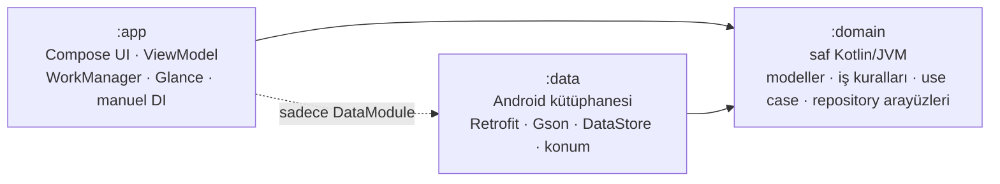

# Hava+ · Havaya göre yol al

Hava durumu uygulaması ve yolculuk planlayıcısı. Hava+ şu anki ve gelecek saatlerin havasını göstermekle yetinmez. **Yolculuk+** ile nereden nereye gideceğini sorar, yürüyüş, bisiklet, araba ve toplu taşımayı rotadaki havaya göre puanlar. Ne zaman çıkarsan kuru kalacağını hesaplar. **Rutinim** ile düzenli yolculuğunu her çıkıştan önce kendisi kontrol eder.

Bilişim Kampı Android eğitimi için sıfırdan yazıldı. Kamp referans projesindeki (`weather-app`) üç katmanlı yapının üzerine çok modüllü bir mimari, iş kuralları için ayrı bir domain katmanı ve kapsamlı birim testleri eklendi.

**Teknoloji:** Kotlin · Jetpack Compose (Material 3) · ViewModel + StateFlow · Coroutines/Flow · Retrofit + Gson · OkHttp · Navigation Compose · DataStore · WorkManager · Jetpack Glance (widget) · JUnit4 + kotlinx-coroutines-test

---

## Özellikler

### Hava
- **Konumunda şimdi:** bulunduğun yerin anlık havası ve yağmurun ne zaman başlayacağı ya da dineceği. Örnek: *"Yağmur 40 dk sonra başlıyor, yaklaşık 1 sa sürecek"*.
- **Favoriler:** her şehir, havasına ve gecenin/gündüzün durumuna göre renklenen bir "gökyüzü kartı" olarak görünür.
- **Tahmin ekranı:**
  - saatlik sıcaklık eğrisi (Bezier) ve yağmur ihtimali çubukları;
  - önümüzdeki 2 saatin 15 dakikalık yağış grafiği;
  - gün doğumu/batımı yayı ve 7 günlük tahmin;
  - detay kutuları: hissedilen, nem, rüzgâr pusulası, UV, basınç, görüş mesafesi, çiy noktası, bulut oranı.
- **Dinamik arka plan:** gökyüzü rengi havaya ve saate göre değişir (açık, bulutlu, yağmurlu, fırtına, kar; gece ve gündüz).
- **Hava sesleri:** isteğe bağlı ortam sesi. Yağmur, rüzgâr, gündüz kuşları, gece cırcır böcekleri.

### Yolculuk+
- **Adres arama:** bina, durak ya da semt aranabilir (Photon). Başlangıç "Konumum" olabilir, gidiş ve dönüş tek dokunuşla yer değiştirir.
- **Açıklanabilir öneri:** her ulaşım türü 100 üzerinden puanlanır. Ağırlıklar: süre %45, hava %35, maliyet %10, efor %10. Puanın nedeni de yazılır. Örnek: *"Bisiklet 6 dk uzun ama yağmura hiç yakalanmazsın."*
- **Rota boyunca hava:** rota noktalara bölünür. Her noktanın havası, o noktadan **geçeceğin andaki** tahminden alınır.
- **Ne zaman çıkmalıyım?** Çıkışı 0 ile 120 dakika arasında kaydırarak her seçenekte yağmurda kaç dakika kalacağını hesaplar ve en iyi çıkış saatini önerir.
- **Yol güvenliği (iki tekerlekli):**
  - yan rüzgâr, rüzgâr yönü ile yolun yönünden hesaplanır: `rüzgâr × |sin(rüzgâr yönü − yol yönü)|`;
  - kuru bir dönemden sonra gelen ilk yağmur yolu kayganlaştırdığı için ayrıca uyarılır.

### Rutinim
- **Kayıt:** düzenli yolculuğu kaydedersin (nereden, nereye, ulaşım türü, günler, saat).
- **Kontrol:** her çıkıştan 30 dk önce WorkManager rotanın havasına bakar. Sadece söylenecek bir şey varsa bildirim gönderir. Örnek: *"Bisiklet ile 9 dk yağmura yakalanırsın. 15 dk erken çıkarsan kuru kalırsın."*
- **Bildirimden açılış:** bildirime dokununca Yolculuk+ o rotayla açılır.

### Ana ekran widget'ı (4×2)
- **Görünüm:** sıcaklık, saatlik eğri ve bir Yolculuk+ satırı. Rutin çıkışın yakınsa o çıkışın sonucunu, değilse önümüzdeki 2 saatin yağmur durumunu gösterir.
- **Güncelleme:** widget arka planda GPS'e gitmez. Uygulamanın en son bulduğu konumu kullanır, yoksa ilk favoriyi.

---

## Mimari

Üç Gradle modülü. Bağımlılık yönü tek: `:app` ve `:data` `:domain`'i bilir, `:domain` hiçbirini bilmez.



| Modül | Ne yapar | Neyi bilmez |
|---|---|---|
| `:domain` | Modeller, iş kuralları (`TripScorer`, `DepartureAdvisor`, `RideSafety`, `RoutineAdvisor`, `WeatherInsights`), use case'ler, repository arayüzleri | Android, Retrofit, ekran. Cümle de üretmez, tipli sonuç döner. |
| `:data` | Open-Meteo, Photon ve OSRM istemcileri, DataStore, Android konum servisi | Ekran. Bütün sınıfları `internal`, dışarıya sadece `DataModule` açık. |
| `:app` | Ekranlar, ViewModel'ler, bildirim, widget, bağımlılıkların kurulduğu `AppContainer` | Retrofit, Gson, DataStore (bu kütüphaneler classpath'inde bile yok) |

```
app/src/main/java/com/ahsen/hava
├── HavaApp.kt · MainActivity.kt · AppActions.kt
├── di/AppContainer.kt          Manuel DI: repository → use case → ViewModel
├── ui/
│   ├── common/                 UiText, DomainText (domain sonucu → strings.xml cümlesi), hata mesajları
│   ├── city/                   Ana sayfa: konumunda şimdi, favori kartları, arama
│   ├── forecast/               Tahmin ekranı ve kartları
│   ├── trip/                   Yolculuk+ ve Rutinim ekranları
│   ├── component/ · theme/     Ortak bileşenler, gökyüzü teması
├── routine/                    Rutin zamanlayıcı, worker, bildirim
├── widget/                     Glance widget'ı
└── sound/                      Hava sesleri

domain/src/main/kotlin/com/ahsen/hava/domain
├── model/ · logic/ · usecase/ · repository/ · error/DataError.kt

data/src/main/java/com/ahsen/hava/data
├── DataModule.kt               Modülün tek açık kapısı
├── remote/                     Retrofit API'leri, DTO'lar, apiCall { } hata çevirici
├── local/                      DataStore (favoriler, rutin, son konum)
└── repository/                 Domain arayüzlerinin gerçek uygulamaları
```

### Tasarım kararları
- **Metin sadece `strings.xml`'de.** Domain cümle üretmez, tipli sonuç döner (`RainOutlook.StartsIn(45)`). Bu sonuçlar `ui/common/DomainText.kt` içinde `strings.xml`'deki metinlere çevrilir. ViewModel'ler `UiText` (metnin kaynak kimliği ve parametreleri) taşır. Aynı cümle ekranda, bildirimde ve widget'ta tek fonksiyondan gelir.
- **Tek hata tipi.** Ağ kütüphanesinin hataları data katmanında `DataError`'a çevrilir (`Network`, `Server(code)`, `InvalidResponse`). Ekran sadece bu üç durumu bilir.
- **Manuel DI.** Bu boyutta bir uygulamada Hilt yerine elle kurulum hem hızlı derlenir hem de bağımlılıkların nereden geldiğini açıkça gösterir. Testlerde sahte repository'ler verilir.
- **Dört durum.** Her ekran `LoadState` ile yükleniyor, veri, boş ve hata durumlarını ele alır. Hatada "Tekrar dene" düğmesi vardır.
- **Açıklanabilir kurallar.** Puanlama bilerek kural tabanlı ve ağırlıklı. Her sayının bir anlamı var ve kullanıcıya "neden" olarak gösterilir.

---

## Testler

Toplam **119 birim testi**. Sahte repository'ler ve test verileri `:domain` modülünün `testFixtures` kaynak kümesinde, diğer modüller de bunları kullanır.

| Modül | Test | Neyi korur |
|---|---|---|
| `:domain` (75) | `TripScorerTest` · `DepartureAdvisorTest` · `RideSafetyTest` · `RoutineAdvisorTest` · `WeatherInsightsTest` | Puanlama, çıkış önerisi, yan rüzgâr/kaygan zemin, rutin uyarıları, yağmur durumu |
| | `PlanTripUseCaseTest` · `CheckRoutineUseCaseTest` · `CheckUpcomingRoutineUseCaseTest` · `GetLocalWeatherUseCaseTest` · `GetWidgetWeatherUseCaseTest` | Use case akışları (havanın çıkış saatine göre değerlendirilmesi, şehir seçme sırası…) |
| | `RoutineTest` · `RouteWeatherTest` · `ModelsTest` | Sıradaki çıkış, rotadaki yağmurun yeri, model hesapları |
| `:data` (16) | `ForecastMappingTest` · `ApiCallTest` · `RoutineCodecTest` | Sütun → satır çevrimi, hata çevirisi, rutin kaydının bozulmaması |
| `:app` (28) | `CityViewModelTest` · `TripViewModelRoutineTest` | ViewModel durumları ve rutin akışı |
| | `RoutineSchedulerTest` · `RoutineMessagesTest` · `WidgetStateTest` · `NormalizedTest` | Zamanlama, bildirim cümleleri, widget içeriği, grafik ölçekleme |

## Çalıştırma

```bash
./gradlew test             # üç modülün birim testleri
./gradlew assembleDebug    # debug APK
./gradlew assembleRelease  # release APK (R8 açık)
```

Android SDK yolu `local.properties` içinde `sdk.dir=...` ile ya da `ANDROID_HOME` ortam değişkeniyle verilir. API anahtarı gerekmez. Her push'ta GitHub Actions testleri ve debug derlemesini çalıştırır (`.github/workflows/ci.yml`).

## Veri kaynakları

| Kaynak | Kullanım | Lisans |
|---|---|---|
| [Open-Meteo](https://open-meteo.com/) | Şehir arama, tahmin, 15 dakikalık yağış, rota boyunca hava | CC BY 4.0 |
| [Photon (Komoot)](https://photon.komoot.io/) | Adres arama | Veri: © OpenStreetMap katkıcıları, ODbL |
| [OSRM (FOSSGIS)](https://routing.openstreetmap.de/) | Yürüyüş, bisiklet ve araba rotaları | Veri: © OpenStreetMap katkıcıları, ODbL |

Ücretsiz servisler ticari olmayan kullanım içindir.

## Kamp kontrol listesi

- [x] Katman kuralları: UI internete gitmiyor, ViewModel çizim yapmıyor, repository ekranı bilmiyor. Modül sınırlarıyla derleme sırasında zorunlu tutuluyor.
- [x] Yeni davranışlar için birim testleri.
- [x] Yükleniyor, veri, boş ve hata durumları.
- [x] Kullanıcıya gösterilen metinler Türkçe, teknik terim içermiyor ve hepsi `strings.xml`'de.
- [x] Commit mesajları Conventional Commits biçiminde.
